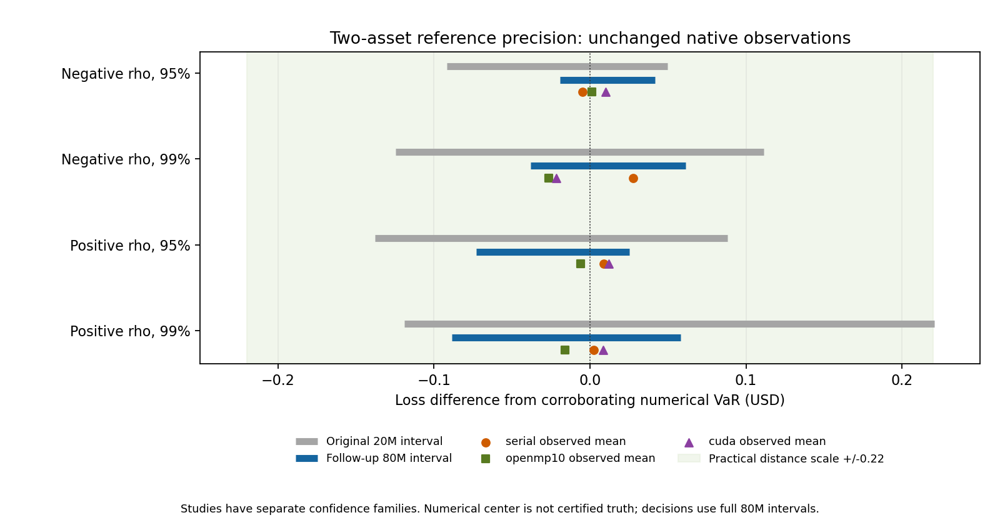

# Two-asset portfolio reference precision follow-up v1

Both fixed **80,000,000-sample** references completed sequentially on Windows,
in 44.0204 seconds total including array hashing. This is a new post-campaign
study; no old protocol, evidence bytes, native observation or engine changed.
There were no retries, seed searches, sample-size extensions or native launches.
The complete two-asset N=10M endpoint reassessment is **12 pass / 0 fail /
0 inconclusive**, for the realized original five-seed means and the unchanged
target `0.0005*V0 = 0.22 USD`. All nine previously inconclusive rows pass here.
This does not establish population-mean equivalence or universal VaR correctness.

The [original study](../portfolio-campaign-20261025/README.md) remains 9/18
passed, 9/18 inconclusive, 0 failed. Its Beta/DKW consistency results and all
six five-identity endpoint passes/reference values remain unchanged. No
five-asset reference, benchmark, sanitizer or native validation was repeated.
Historical calibration and portfolio hybrid development were not performed.

## Freeze, scope and coverage

[protocol-v1.json](protocol-v1.json) was written and hashed before new samples.
Its exact-byte SHA-256 is
`e214d3c9f56c3a4a8601d550861042e850a70d21af628eca7506615a46ce8182`.
[freeze-v1.json](freeze-v1.json) binds the protocol, generating source and
every original campaign package file, including its primary-selection record.
This additionally detects any alteration of the original evidence tree.

Two-asset fixtures are byte-identical to the originals: ALPHA then BETA,
quantities 2/3, prices 100/80, annual price drifts .05/.03, volatilities .20/.30,
T=1 year, USD, rho=-.6 or +.6. V0=440. Seeds are 1749202601 (negative) and
1749202602 (positive), disjoint from old reference/native labels. Their PRNG
streams model independent samples; disjoint labels are not a mathematical
proof of random-stream independence. PCG64DXSM float64 normal generation,
explicit bivariate correlation and terminal-price summation use no production
Cholesky, valuation, RNG or quantile helper.

The new confidence family consists of **four reference quantiles**: both .95
and .99 for both fixtures. Per-interval error is .01/4=.0025; checked exact
binomial rank probabilities give at least 99% simultaneous coverage by the
union bound under continuous ideal-iid sampling. The twelve reused observed
means introduce no additional estimated-reference intervals. Decisions use
the maximum distance from the observed mean to either interval endpoint;
distance beyond target fails and unresolved overlap is inconclusive.
Reference half-width above .11 would force inconclusive regardless of mean.

Original and follow-up coverage statements are **separate**. There is no
combined 99% assertion. Original per-interval error was .0025/6; the new study
allocates its entire .01 budget to four intervals. Narrower intervals reflect
both four times as many samples and this different, predeclared allocation;
they are not a pure sample-size comparison at identical marginal coverage.
No reference sample is exact truth or a promise of sufficient precision.

## Reference results and interval widths

All numbers below are USD, rounded for display. Full precision, ranks, actual
coverage, array hashes, moments and durations: [reference.json](reference.json).
The target is .22 and the width guard is .22 for every row.

| Fixture | Alpha | Original interval | Original width | New 80M estimate | New interval | New width | Numerical VaR |
| --- | --- | --- | --- | --- | --- | --- | --- |
| two-negative | .95 | [70.442590,70.583956] | .141367 | 70.545947 | [70.514903,70.575805] | .060902 | 70.534213 |
| two-negative | .99 | [98.203468,98.439251] | .235783 | 98.339994 | [98.289834,98.389361] | .099527 | 98.327981 |
| two-positive | .95 | [133.050426,133.276727] | .226301 | 133.164211 | [133.115524,133.213511] | .097987 | 133.188390 |
| two-positive | .99 | [176.270991,176.610487] | .339496 | 176.374784 | [176.301233,176.448069] | .146836 | 176.389909 |

[reassessment.csv](reassessment.csv) contains all twelve endpoint rows with
unchanged full-precision means, old status/reference/interval, new estimate/
interval, numerical estimate/error diagnostics, target, worst error and reason.
The original three two-negative .95 rows remain passes. Specifically, the nine
originally inconclusive rows are:

| Fixture | Alpha | Engine | Reused observed mean | New worst error | Follow-up |
| --- | --- | --- | --- | --- | --- |
| two-negative | .99 | serial | 98.355742096 | .065908251 | pass |
| two-negative | .99 | openmp10 | 98.301664475 | .087696474 | pass |
| two-negative | .99 | cuda | 98.306191528 | .083169422 | pass |
| two-positive | .95 | serial | 133.197248215 | .081723742 | pass |
| two-positive | .95 | openmp10 | 133.182305377 | .066780905 | pass |
| two-positive | .95 | cuda | 133.200373325 | .084848853 | pass |
| two-positive | .99 | serial | 176.392339270 | .091106101 | pass |
| two-positive | .99 | openmp10 | 176.373997254 | .074071483 | pass |
| two-positive | .99 | cuda | 176.398486373 | .097253204 | pass |

The changed decisions arise from refined reference precision; no engine
disagreement or suspected engine defect was observed. No smaller-N outcomes
or old consistency outcomes were replaced.



The plot is centered on the corroborating numerical result, not on certified
truth. The shaded +/- .22 is a distance scale, not the acceptance region for
an entire interval: each mean must be within .22 of **both** new endpoints.
[figure-data.json](figure-data.json) exports the exact plotted table values.
The rendered PNG was inspected; its data are independently checked against CSV.

## Independent conditional numerical calculation

Let independent standard normals be Z and E. Write ordered terminal holdings as
`X=exp(b1+c1*Z)` and `Y=exp(b2+c2*(rho*Z+sqrt(1-rho^2)*E))`, where
`bi=log(qi*S0i)+(mui-sigmai^2/2)*T`, `ci=sigmai*sqrt(T)`. For s>0, conditioning
on Z=z makes X a constant and log(Y) normal. When X>=s, positive Y makes the
conditional probability zero. Otherwise:

```text
F_X+Y(s) = integral_{z: exp(b1+c1*z)<s} phi(z)
             * Phi((log(s-exp(b1+c1*z))-b2-rho*c2*z)
                   /(c2*sqrt(1-rho^2))) dz.
```

We independently derived this expression from the scalar conditional Gaussian;
it is not a lognormal approximation to a sum. Solve `F(s)=1-alpha` and report
`VaR=V0-s`. The finite-sample loss nearest-rank selection and population
lower-terminal quantile conversion are different operations; neither averages
asset or chunk VaRs. Conditional variance is `c2^2*(1-rho^2)` in the original
asset order. Swapping both asset parameter rows leaves the correlation model
unchanged and tests a different conditioning direction.

For X<s, the stable remainder uses
`log(s)+log(-expm1(log(X)-log(s)))`. This avoids cancellation near X=s and
avoids constructing X in overflow regions. All-zero horizon/volatility reduces
to deterministic CDF; one zero volatility reduces to shifted one-lognormal CDF.

Primary integration uses Z in [-10,10], split at integers and at the X=s
crossing, QUADPACK adaptive quadrature with absolute and relative tolerances
2e-11 (absolute budget divided across pieces). Omitted integrand mass is at
most `2*Phi(-10)=1.524e-23` in exact arithmetic. Tight integration uses [-12,12]
and 2e-13. A materially different calculation transforms u=Phi(z) and integrates
the conditional CDF over [0,Phi(crossing)], with probability partitions and no
intentional tail truncation. Numerical floating-point evaluation is still
subject to error. Every SciPy IntegrationWarning is promoted to failure.

Brent inversion brackets [0,2*V0], allowing at most 30 doublings. Root maximum
iterations is 100; primary xtol=1e-9, rtol=1e-13; tight xtol=1e-11. Residuals,
iterations and expansions are recorded. Estimated CDF error is the sum of
quadrature error estimates, analytic omitted tail and root CDF residual.
Inverting at p plus/minus that estimate gives a local quantile sensitivity
diagnostic; it is not a rigorous enclosure. Root stopping tolerance remains
an additional numerical scale (about 1.04e-9 USD primary, 4.7e-11 USD tight).

All four methods (primary, swapped order, tighter tolerances and probability
transform) agree within **9.09e-11 USD** across these four quantiles. Numerical
VaR differs from the 80M estimate by at most .024180 USD and is inside every
new rank interval. All per-mode estimated propagated errors, residuals and
quadrature estimates are retained in [numerical.json](numerical.json).
No warnings or root failures occurred. These estimates, empirical agreement
and moment checks do not certify the true total floating-point/integration
error. Numerical values are **corroboration only**, excluded from acceptance.

Implementation semantics were checked against the installed SciPy 1.10.1 and
official [quad documentation](https://docs.scipy.org/doc/scipy-1.10.1/reference/generated/scipy.integrate.quad.html)
(absolute error is an estimate) and
[brentq documentation](https://docs.scipy.org/doc/scipy-1.10.1/reference/generated/scipy.optimize.brentq.html)
(bracket and stopping tolerances). The formula above is our independent derivation.
No five-dimensional integration was implemented.

## Reproduction, data and verification

Generating/analysis source: [portfolio_precision.py](../../scripts/portfolio_precision.py).
Baseline HEAD was e0fc594f14bd1814856c668132e21808d1826083. Execution used
uncommitted new tooling whose exact source bytes were frozen, not attributed
to the baseline Git blob. Local exact-byte SHA-256 is distinguished from Git
blob identities; evidence and the generator use explicit `-text` attributes.
Python 3.11.4/NumPy 1.24.3/SciPy 1.10.1 were already installed; no installation,
account switch or system change occurred. Runtime identities are retained.

Original observations come from `evidence/portfolio-campaign-20261025/validation-raw.csv`
and `convergence.csv`, bound by the freeze ledger. Original ignored native
launch records remain under `results/portfolio-campaign-20261025/processes/`.
New globally sorted NPY arrays are retained locally, ignored, each 640000128
bytes, at `results/portfolio-precision-20261025-v1/two-negative.npy` and
`two-positive.npy`. Their exact-byte hashes are in reference.json. Arrays are
not uploaded; no historical provider data is involved. The two fixtures run
sequentially in 250k chunks with one mapped scalar array, not a full 80M-by-2
normal matrix; global in-place sorting selects exact sample ranks. Full new
raw information consists of these sorted losses plus public summaries, seeds,
source and inputs; unsorted shocks were not retained. This is not a speed
benchmark, and memory use includes OS mapped-file cache.

Actual commands used the existing executable `C:/Users/rahma/anaconda3/python.exe`:

```powershell
& C:/Users/rahma/anaconda3/python.exe -B -m unittest discover -s tests -p test_portfolio_precision.py -v
# Preparation only, already completed. DO NOT regenerate the published attempt:
& C:/Users/rahma/anaconda3/python.exe -B scripts/portfolio_precision.py freeze
& C:/Users/rahma/anaconda3/python.exe -B scripts/portfolio_precision.py reference
& C:/Users/rahma/anaconda3/python.exe -B scripts/portfolio_precision.py numerical
# Small reproducible analyses/read-only checks:
& C:/Users/rahma/anaconda3/python.exe -B scripts/portfolio_precision.py reassess
& C:/Users/rahma/anaconda3/python.exe -B scripts/plot_portfolio_precision.py
& C:/Users/rahma/anaconda3/python.exe -B scripts/verify_portfolio_precision.py --local
& C:/Users/rahma/anaconda3/python.exe -B scripts/verify_portfolio_campaign.py
```

Large execution refuses an existing local attempt directory; numerical execution
refuses an existing record. A new independent reproduction needs an isolated
checkout with the generated public directory removed before freeze (preserve
the original package elsewhere); run the unmodified source and compare new
outputs by hash. Do not overwrite retained arrays or launch another confirmatory
follow-up to seek a preferred outcome. The frozen 80M/fixture ceiling remains.

Eight focused tests passed, including deterministic and single-random-asset
reductions, explicit small scenarios, negative deterministic VaR, exact moments,
rank coverage, numerical modes and deliberate corrupted-observation/decision
rejection. Three retained original campaign tooling tests also passed.
Local verification checked both full array
hashes, dtype/size, global sorting/finiteness and quantile/interval ranks. Public
checks reconstruct all reused means/decisions and historical evidence hashes.
Hosted CI is configured for published arithmetic/integrity and focused tests;
it never launches 80M generation and does not reproduce local reference execution.
See [completion.json](completion.json), [verification.json](verification.json),
[artifact-sha256.json](artifact-sha256.json) and [delivery.json](delivery.json).

Local Git staging was denied creating `.git/index.lock`; Git network access
also failed TLS credentials and `gh auth status` reported an invalid local token.
The connected read-only GitHub tool independently resolved remote main to the
same e0fc594 baseline. No new commit, push or exact-SHA CI is claimed. The
task-specific delivery script validates scope/hashes, performs a normal delivery
and waits for the exact pushed SHA; it is the remaining normal-PowerShell step.
